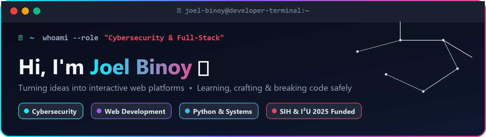

<div align="center">

  <!-- Self-Hosted High-Resolution Cyber Banner (100% Reliable PNG) -->
  <a href="https://github.com/joelbinoy2021-sketch">
    
  </a>

  <br/>

  <!-- Mobile-Responsive Typing Animation -->
  <a href="https://github.com/joelbinoy2021-sketch">
    
  </a>

  <br/><br/>

  <!-- Quick Action Badges -->
  <a href="https://joelbinoy2021-sketch.github.io/joel-portfolio/" target="_blank"></a>&nbsp;
  <a href="https://www.linkedin.com/in/joel-binoy-144141279" target="_blank"></a>&nbsp;
  <a href="mailto:joelbinoy2021@gmail.com"></a>&nbsp;
  <a href="https://github.com/joelbinoy2021-sketch?tab=repositories"></a>

</div>

---

### 🧑‍💻 About Me

```yaml
identity:
  name: Joel Binoy
  role: Computer Science & Engineering Undergraduate
  institution: Amal Jyothi College of Engineering, Kanjirappally
  interests: [Cybersecurity, Full-Stack Web, Network Defense, IoT]
  mission: "Turning ideas into interactive web platforms & breaking code safely."
```

- 🎓 **Academics**: B.Tech CSE student focused on software engineering, secure architecture, and systems programming.
- 🛡️ **Cybersecurity**: Enthusiastic about network security, vulnerability assessment, ethical hacking principles, and secure coding.
- 💻 **Web Engineering**: Crafting interactive user interfaces, scalable REST backends, and responsive platforms.
- 🏆 **Hackathons & Awards**: Smart India Hackathon (SIH) contributor & innovator on an **I²U 2025 funded project**.
- 📍 **Location**: Kerala, India

---

### 🛠️ Tech Stack & Skills

<div align="center">

  <!-- Interactive Icon Grid -->
  <a href="https://skillicons.dev">
    
  </a>

  <br/><br/>

</div>

| Category | Technologies & Tools |
|:---|:---|
| **Languages & Core** | `Python` • `C` • `Java` • `JavaScript (ES6+)` • `SQL` • `HTML5` • `CSS3` |
| **Cybersecurity & Systems** | `Linux (Kali/Ubuntu)` • `Bash Scripting` • `Network Protocols` • `OWASP Fundamentals` • `OOP` |
| **Databases** | `MySQL` • `PostgreSQL` • `Database Design` |
| **Tools & Platforms** | `Git` • `GitHub` • `VS Code` • `Figma` • `Vercel` • `Formspree` |

---

### 🚀 Featured Projects

#### ⚡ [SkillSprint](https://github.com/joelbinoy2021-sketch/SkillSprint)
> **Interactive Learning Platform for Web Dev, Python & Cybersecurity**  
> An educational web app featuring structured roadmaps, interactive quizzes, and coding challenges designed to teach programming and cybersecurity concepts hands-on.  
> `Python` &bull; `Full-Stack Web` &bull; `Cybersecurity Labs` &bull; `Interactive UI`

#### 🏛️ [FDRFLOW — SIH 2024](https://github.com/joelbinoy2021-sketch/fdrflow-sih)
> **Security Deposit & FDR Management Portal for AICTE Regulation Bureau**  
> Streamlined solution developed for the AICTE problem statement in Smart India Hackathon to digitize, verify, and monitor Fixed Deposit Receipts and regulatory compliances across institutions.  
> `AICTE SIH` &bull; `Regulatory Portal` &bull; `Relational Database` &bull; `Secure Workflows`

#### 🌊 [Smart Floating Plastic Separator](https://github.com/joelbinoy2021-sketch/Smart-Floating-Plastic-Separator)
> **Autonomous Aquatic Waste Collection System (I²U 2025 Funded)**  
> Autonomous, solar-powered floating hardware-software solution engineered to detect and harvest plastic pollution in aquatic environments. Selected for project funding at **Innovation Ideas Unleashed 2025**.  
> `IoT` &bull; `CleanTech Hardware` &bull; `Autonomous Navigation` &bull; `Environmental Tech`

#### 🏙️ [CivicFix 1.0](https://github.com/joelbinoy2021-sketch/CivicFix1.0)
> **Smart Citizen Municipal Grievance Redressal System**  
> Mobile-first platform empowering citizens to report local civic issues via geo-tagged photos with automated routing and real-time status tracking.  
> `Mobile Web` &bull; `Geolocation API` &bull; `Civic Tech` &bull; `RESTful APIs`

#### 🌐 [Interactive Cyber Portfolio](https://joelbinoy2021-sketch.github.io/joel-portfolio/)
> **Personal Developer Portfolio with Particle Canvas & Terminal Console**  
> Fully responsive portfolio featuring interactive HTML5 particle physics, glowing cyber aesthetics, project modals, and a functional hacker-theme terminal simulator.  
> `HTML5 Canvas` &bull; `CSS Glassmorphism` &bull; `Vanilla JavaScript` &bull; `Terminal Logic`

---

### 🏆 Honors & Certifications

- 💡 **Innovation Ideas Unleashed (I²U) 2025** — Project Selected for Funding (Amal Jyothi College of Engineering)
- 🇮🇳 **Smart India Hackathon 2025 (SIH)** — Certificate of Appreciation (MakerHub IEDC AJCE / Ministry of Education)
- 🎨 **Figma Bootcamp Certification** — LetsUpgrade / NSDC / GDG MAD

---

### 📊 GitHub Activity & Analytics

<div align="center">
  <a href="https://github.com/joelbinoy2021-sketch">
    
  </a>
  <a href="https://github.com/joelbinoy2021-sketch">
    
  </a>
</div>

<br/>

<div align="center">
  <a href="https://github.com/joelbinoy2021-sketch">
    
  </a>
</div>

---

### 📬 Connect With Me

<div align="center">

  Ready to collaborate or discuss an exciting project? Let's connect!

  <br/><br/>

  <a href="mailto:joelbinoy2021@gmail.com"></a>&nbsp;
  <a href="https://www.linkedin.com/in/joel-binoy-144141279" target="_blank"></a>&nbsp;
  <a href="https://joelbinoy2021-sketch.github.io/joel-portfolio/" target="_blank"></a>

  <br/><br/>

  <!-- Footer Divider -->
  

</div>
